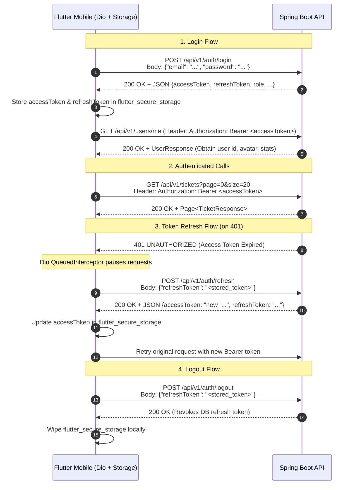

# Reconciled API Contract & Integration Specification for Flutter Mobile

> **Audience**: Flutter Mobile Engineering Team & Spring Boot Backend Team  
> **Source Verification**: Verified directly against source code in [`helpdesk`](file:///D:/Course%20Wing/Final/fix/helpdesk) and [`helpdesk-frontend`](file:///D:/Course%20Wing/Final/fix/helpdesk-frontend). Where existing documentation disagreed with the codebase, the actual source code was taken as the source of truth.

---

## 1. Executive Summary & Protocol Architecture

The Helpdesk system utilizes a hybrid communication architecture:
1. **REST APIs**: Synchronous request/response interactions running on base path `/api/v1/*` using standard JSON and multipart form data.
2. **WebSocket (STOMP Protocol)**: Bi-directional event messaging mounted at `/ws-chat` for ticket chat communications.

### 1.1 Web vs. Mobile Protocol Comparison
* **Web Client Architecture**: The Next.js web portal routes all REST calls through a local server proxy ([`src/app/api/v1/[...path]/route.ts`](file:///D:/Course%20Wing/Final/fix/helpdesk-frontend/src/app/api/v1/[...path]/route.ts)) to bypass browser CORS and delete incoming `Host` headers. The web chat connects directly to `${backendUrl}/ws-chat` using `SockJS` emulation.
* **Flutter Mobile Architecture**: Native mobile applications (Android/iOS) run directly against the Spring Boot backend origin (`http://<host>:8080/api/v1` or Railway production URL). Native mobile HTTP clients (`Dio`) do not enforce browser CORS restrictions. However, Flutter does not run a browser JavaScript engine, requiring a **pure WebSocket STOMP endpoint** rather than SockJS emulation.

---

## 2. Comprehensive Endpoint Reconciliation Table

The following master table reconciles every endpoint documented across [`backend-analysis/03-endpoints.md`](file:///D:/Course%20Wing/Final/fix/helpdesk/docs/backend-analysis/03-endpoints.md) and [`mobile-migration/04-api-contract.md`](file:///D:/Course%20Wing/Final/fix/helpdesk-frontend/docs/mobile-migration/04-api-contract.md) with the actual code in both repositories.

| # | Endpoint & Method | Exists in Backend? | Used by Frontend? | Request/Response Match? | Status Code Match? | Reconciliation Finding / Problem |
|---|---|---|---|---|---|---|
| **1** | `POST /api/v1/auth/login` | **Yes** ([AuthController.java#L24](file:///D:/Course%20Wing/Final/fix/helpdesk/src/main/java/com/zaby/helpdesk/controller/AuthController.java#L24)) | **Yes** ([authApi.ts#L22](file:///D:/Course%20Wing/Final/fix/helpdesk-frontend/src/redux/feature/auth/authApi.ts#L22)) | **Partial Match** | **Match** (200, 401) | Backend `AuthResponse` lacks `id` and `imageUrl`. Web `transformResponse` attempts to read `response.id`, resulting in `undefined` in client store. Backend sets `Set-Cookie` which mobile should ignore. |
| **2** | `POST /api/v1/auth/refresh` | **Yes** ([AuthController.java#L30](file:///D:/Course%20Wing/Final/fix/helpdesk/src/main/java/com/zaby/helpdesk/controller/AuthController.java#L30)) | **Yes** ([authApi.ts#L54](file:///D:/Course%20Wing/Final/fix/helpdesk-frontend/src/redux/feature/auth/authApi.ts#L54)) | **Match** | **Partial Match** (200, 401; 500 on bug) | Backend crashes with HTTP 500 (`NullPointerException` at line 52) if the user has `department == null`. |
| **3** | `POST /api/v1/auth/logout` | **Yes** ([AuthController.java#L59](file:///D:/Course%20Wing/Final/fix/helpdesk/src/main/java/com/zaby/helpdesk/controller/AuthController.java#L59)) | **Yes** ([authApi.ts#L61](file:///D:/Course%20Wing/Final/fix/helpdesk-frontend/src/redux/feature/auth/authApi.ts#L61)) | **Mismatch** | **Match** (200) | Backend expects `{ "refreshToken": "..." }` in request body to delete DB record. Web frontend sends empty body `{}`, so tokens are never deleted in DB upon web logout. Flutter must pass the token. |
| **4** | `POST /api/v1/tickets` | **Yes** ([TicketController.java#L23](file:///D:/Course%20Wing/Final/fix/helpdesk/src/main/java/com/zaby/helpdesk/controller/TicketController.java#L23)) | **Yes** ([ticketApi.ts#L99](file:///D:/Course%20Wing/Final/fix/helpdesk-frontend/src/redux/feature/ticket/ticketApi.ts#L99)) | **Partial Match** | **Match** (201) | Web sends `status: "PENDING"` which backend ignores (backend initializes status). Backend lacks `@Valid` on controller parameter. |
| **5** | `GET /api/v1/tickets/{id}` | **Yes** ([TicketController.java#L30](file:///D:/Course%20Wing/Final/fix/helpdesk/src/main/java/com/zaby/helpdesk/controller/TicketController.java#L30)) | **Yes** ([ticketApi.ts#L66](file:///D:/Course%20Wing/Final/fix/helpdesk-frontend/src/redux/feature/ticket/ticketApi.ts#L66)) | **Match** | **Partial Match** (200; 500 instead of 404) | Returns full `TicketResponse` including nested logs. When ticket not found, backend throws `RuntimeException`, returning 500 instead of 404. Dates formatted `"yyyy-MM-dd HH:mm:ss"`. |
| **6** | `GET /api/v1/tickets` | **Yes** ([TicketController.java#L37](file:///D:/Course%20Wing/Final/fix/helpdesk/src/main/java/com/zaby/helpdesk/controller/TicketController.java#L37)) | **Yes** ([ticketApi.ts#L56](file:///D:/Course%20Wing/Final/fix/helpdesk-frontend/src/redux/feature/ticket/ticketApi.ts#L56)) | **Mismatch** | **Match** (200) | Backend returns Spring `Page<TicketResponse>` with default `size=10`. Web frontend passes no params and extracts `content`, silently truncating data to 10 items. Backend does not support `?status=` or `?search=`. |
| **7** | `GET /api/v1/tickets/history` | **Yes** ([TicketController.java#L44](file:///D:/Course%20Wing/Final/fix/helpdesk/src/main/java/com/zaby/helpdesk/controller/TicketController.java#L44)) | **Yes** ([ticketApi.ts#L61](file:///D:/Course%20Wing/Final/fix/helpdesk-frontend/src/redux/feature/ticket/ticketApi.ts#L61)) | **Mismatch** | **Match** (200) | Paginated (`Page<TicketResponse>`). Same pagination truncation issue as `GET /tickets`. Automatically filters completed tickets based on caller's role. |
| **8** | `GET /api/v1/tickets/my` | **Yes** ([TicketController.java#L56](file:///D:/Course%20Wing/Final/fix/helpdesk/src/main/java/com/zaby/helpdesk/controller/TicketController.java#L56)) | **Yes** ([ticketApi.ts#L74](file:///D:/Course%20Wing/Final/fix/helpdesk-frontend/src/redux/feature/ticket/ticketApi.ts#L74)) | **Mismatch** | **Match** (200) | Paginated (`Page<TicketResponse>`). Same pagination truncation issue. Filtered to non-completed tickets created by caller. |
| **9** | `PATCH /api/v1/tickets/{id}/status` | **Yes** ([TicketController.java#L67](file:///D:/Course%20Wing/Final/fix/helpdesk/src/main/java/com/zaby/helpdesk/controller/TicketController.java#L67)) | **Yes** ([ticketApi.ts#L107](file:///D:/Course%20Wing/Final/fix/helpdesk-frontend/src/redux/feature/ticket/ticketApi.ts#L107)) | **Match** | **Partial Match** (200; 500 instead of 400) | Request body `{ status, remark }`. Backend throws unhandled `IllegalArgumentException` on invalid transition (e.g. Completed -> In Progress), returning 500 instead of 400. |
| **10** | `PUT /api/v1/tickets/{id}` | **Yes** ([TicketController.java#L78](file:///D:/Course%20Wing/Final/fix/helpdesk/src/main/java/com/zaby/helpdesk/controller/TicketController.java#L78)) | **No** (Broken in web) | **N/A** | **Match** (200) | Web route `/tickets/[id]/edit` erroneously calls `POST /tickets`. Backend has full `PUT` implementation, but lacks ownership checks (any authenticated user can edit any ticket). |
| **11** | `DELETE /api/v1/tickets/{id}` | **Yes** ([TicketController.java#L85](file:///D:/Course%20Wing/Final/fix/helpdesk/src/main/java/com/zaby/helpdesk/controller/TicketController.java#L85)) | **No** (Unused) | **N/A** | **Match** (204) | Soft-deletes ticket. Never implemented or called by web frontend. |
| **12** | `GET /api/v1/tickets/stats` | **Yes** ([TicketController.java#L94](file:///D:/Course%20Wing/Final/fix/helpdesk/src/main/java/com/zaby/helpdesk/controller/TicketController.java#L94)) | **Yes** ([ticketApi.ts#L83](file:///D:/Course%20Wing/Final/fix/helpdesk-frontend/src/redux/feature/ticket/ticketApi.ts#L83)) | **Match** | **Match** (200) | Returns KPI counters: `totalTickets`, `pendingTickets`, `inProgressTickets`, `completedTickets`, `totalUsers`. |
| **13** | `GET /api/v1/tickets/stats/monthly` | **Yes** ([TicketController.java#L100](file:///D:/Course%20Wing/Final/fix/helpdesk/src/main/java/com/zaby/helpdesk/controller/TicketController.java#L100)) | **Yes** ([ticketApi.ts#L87](file:///D:/Course%20Wing/Final/fix/helpdesk-frontend/src/redux/feature/ticket/ticketApi.ts#L87)) | **Match** | **Match** (200) | Takes optional `?year=`. Returns 12-element arrays: `received` (Completed) and `due` (Pending + In Progress). |
| **14** | `GET /api/v1/tickets/activity` | **Yes** ([TicketController.java#L109](file:///D:/Course%20Wing/Final/fix/helpdesk/src/main/java/com/zaby/helpdesk/controller/TicketController.java#L109)) | **Partial** (Commented out in UI) | **Match** | **Match** (200) | Paginated (`Page<NotificationResponse>`). Returns derived history feed. Web header comments out the bell icon; backend avatar paths are relative web paths (`/images/user/...`). |
| **15** | `GET /api/v1/status_log/ticket/{ticketId}` | **Yes** ([TicketStatusLogController.java#L22](file:///D:/Course%20Wing/Final/fix/helpdesk/src/main/java/com/zaby/helpdesk/controller/TicketStatusLogController.java#L22)) | **No** (Unused) | **N/A** | **Match** (200) | Returns `List<TicketStatusLogResponse>`. Web frontend does not call this because `TicketResponse.logs` already contains this data. |
| **16** | `GET /api/v1/history/ticket/{ticketId}` | **Yes** ([TicketHistoryController.java#L21](file:///D:/Course%20Wing/Final/fix/helpdesk/src/main/java/com/zaby/helpdesk/controller/TicketHistoryController.java#L21)) | **No** (Unused) | **N/A** | **Match** (200) | Returns `List<TicketHistoryResponse>` (audit trail of create, assign, update, resolve actions). Never called by web. |
| **17** | `POST /api/v1/categories` | **Yes** ([CategoryController.java#L21](file:///D:/Course%20Wing/Final/fix/helpdesk/src/main/java/com/zaby/helpdesk/controller/CategoryController.java#L21)) | **Yes** ([categoryApi.ts#L23](file:///D:/Course%20Wing/Final/fix/helpdesk-frontend/src/redux/feature/category/categoryApi.ts#L23)) | **Match** | **Match** (201) | Restricted to `ADMIN` and `TECHNICIAN`. Takes `name`, `description`, optional `parentId`. |
| **18** | `PUT /api/v1/categories/{id}` | **Yes** ([CategoryController.java#L29](file:///D:/Course%20Wing/Final/fix/helpdesk/src/main/java/com/zaby/helpdesk/controller/CategoryController.java#L29)) | **Partial** (Defined in RTK, no UI) | **Match** | **Match** (200) | Restricted to `ADMIN` and `TECHNICIAN`. Throws `BusinessException` on circular parenting. Web UI has no category edit button. |
| **19** | `GET /api/v1/categories` | **Yes** ([CategoryController.java#L37](file:///D:/Course%20Wing/Final/fix/helpdesk/src/main/java/com/zaby/helpdesk/controller/CategoryController.java#L37)) | **Yes** ([categoryApi.ts#L19](file:///D:/Course%20Wing/Final/fix/helpdesk-frontend/src/redux/feature/category/categoryApi.ts#L19)) | **Match** | **Match** (200) | Returns hierarchical `List<CategoryResponse>` where root items have nested `subCategories`. Unpaginated. |
| **20** | `GET /api/v1/categories/{id}` | **Yes** ([CategoryController.java#L44](file:///D:/Course%20Wing/Final/fix/helpdesk/src/main/java/com/zaby/helpdesk/controller/CategoryController.java#L44)) | **No** (Unused) | **N/A** | **Match** (200, 404) | Returns single category. Web finds category in memory from `GET /categories`. |
| **21** | `DELETE /api/v1/categories/{id}` | **Yes** ([CategoryController.java#L51](file:///D:/Course%20Wing/Final/fix/helpdesk/src/main/java/com/zaby/helpdesk/controller/CategoryController.java#L51)) | **Yes** ([categoryApi.ts#L39](file:///D:/Course%20Wing/Final/fix/helpdesk-frontend/src/redux/feature/category/categoryApi.ts#L39)) | **Match** | **Match** (204) | Restricted to `ADMIN` and `TECHNICIAN`. Throws `BusinessException` (400) if category is referenced by existing tickets. |
| **22** | `POST /api/v1/departments` | **Yes** ([DepartmentController.java#L20](file:///D:/Course%20Wing/Final/fix/helpdesk/src/main/java/com/zaby/helpdesk/controller/DepartmentController.java#L20)) | **Yes** ([departmentApi.ts#L18](file:///D:/Course%20Wing/Final/fix/helpdesk-frontend/src/redux/feature/department/departmentApi.ts#L18)) | **Match** | **Match** (201) | Restricted to `ADMIN`. Frontend sends `{ name }`; backend accepts optional `description`. |
| **23** | `PUT /api/v1/departments/{id}` | **Yes** ([DepartmentController.java#L27](file:///D:/Course%20Wing/Final/fix/helpdesk/src/main/java/com/zaby/helpdesk/controller/DepartmentController.java#L27)) | **No** (Unused) | **N/A** | **Match** (200) | Restricted to `ADMIN`. Never used by web frontend. |
| **24** | `GET /api/v1/departments/{id}` | **Yes** ([DepartmentController.java#L34](file:///D:/Course%20Wing/Final/fix/helpdesk/src/main/java/com/zaby/helpdesk/controller/DepartmentController.java#L34)) | **No** (Unused) | **N/A** | **Match** (200) | Never used by web frontend. |
| **25** | `GET /api/v1/departments` | **Yes** ([DepartmentController.java#L41](file:///D:/Course%20Wing/Final/fix/helpdesk/src/main/java/com/zaby/helpdesk/controller/DepartmentController.java#L41)) | **Yes** ([departmentApi.ts#L14](file:///D:/Course%20Wing/Final/fix/helpdesk-frontend/src/redux/feature/department/departmentApi.ts#L14)) | **Match** | **Match** (200) | Returns raw `List<DepartmentResponse>`. Accessible to all authenticated users. |
| **26** | `POST /api/v1/users` | **Yes** ([UserController.java#L24](file:///D:/Course%20Wing/Final/fix/helpdesk/src/main/java/com/zaby/helpdesk/controller/UserController.java#L24)) | **Yes** ([userApi.ts#L37](file:///D:/Course%20Wing/Final/fix/helpdesk-frontend/src/redux/feature/user/userApi.ts#L37)) | **Partial Match** | **Partial Match** (201; 500 instead of 409) | Restricted to `ADMIN`. Frontend sends `departmentId` as string or number. Duplicate email throws `RuntimeException`, causing 500 instead of 409 Conflict. |
| **27** | `GET /api/v1/users/me` | **Yes** ([UserController.java#L30](file:///D:/Course%20Wing/Final/fix/helpdesk/src/main/java/com/zaby/helpdesk/controller/UserController.java#L30)) | **No** (Web uses broken `/users/{id}`) | **N/A** | **Match** (200) | Accessible to any authenticated caller. Returns full `UserResponse` with ticket stats. Web frontend mistakenly does not call this, and calls admin-only `/users/{id}` instead. |
| **28** | `GET /api/v1/users/{id}` | **Yes** ([UserController.java#L42](file:///D:/Course%20Wing/Final/fix/helpdesk/src/main/java/com/zaby/helpdesk/controller/UserController.java#L42)) | **Yes** ([userApi.ts#L52](file:///D:/Course%20Wing/Final/fix/helpdesk-frontend/src/redux/feature/user/userApi.ts#L52)) | **Match** | **Mismatch** (200 vs 403) | Backend restricts `GET /api/v1/users/**` to `ROLE_ADMIN` in [SecurityConfig.java#L55](file:///D:/Course%20Wing/Final/fix/helpdesk/src/main/java/com/zaby/helpdesk/security/SecurityConfig.java#L55). Web Profile screen calls this for normal users and gets 403 Forbidden! |
| **29** | `GET /api/v1/users` | **Yes** ([UserController.java#L49](file:///D:/Course%20Wing/Final/fix/helpdesk/src/main/java/com/zaby/helpdesk/controller/UserController.java#L49)) | **Yes** ([userApi.ts#L33](file:///D:/Course%20Wing/Final/fix/helpdesk-frontend/src/redux/feature/user/userApi.ts#L33)) | **Match** | **Match** (200) | Restricted to `ADMIN`. Returns unpaginated `List<UserResponse>`. Unbounded payload hazard. |
| **30** | `PUT /api/v1/users/{id}` | **Yes** ([UserController.java#L56](file:///D:/Course%20Wing/Final/fix/helpdesk/src/main/java/com/zaby/helpdesk/controller/UserController.java#L56)) | **Yes** ([userApi.ts#L56](file:///D:/Course%20Wing/Final/fix/helpdesk-frontend/src/redux/feature/user/userApi.ts#L56)) | **Match** | **Match** (200) | Restricted to `ADMIN`. Normal users cannot change own profile or password. |
| **31** | `DELETE /api/v1/users/{id}` | **Yes** ([UserController.java#L63](file:///D:/Course%20Wing/Final/fix/helpdesk/src/main/java/com/zaby/helpdesk/controller/UserController.java#L63)) | **Yes** ([userApi.ts#L45](file:///D:/Course%20Wing/Final/fix/helpdesk-frontend/src/redux/feature/user/userApi.ts#L45)) | **Mismatch** | **Mismatch** (200 vs 204) | Backend returns `200 OK` with the deleted `UserResponse` entity. Frontend docs and RTK types expect empty `204 No Content`. |
| **32** | `POST /api/v1/images/upload` | **Yes** ([ImageController.java#L21](file:///D:/Course%20Wing/Final/fix/helpdesk/src/main/java/com/zaby/helpdesk/controller/ImageController.java#L21)) | **Yes** ([ticketApi.ts#L115](file:///D:/Course%20Wing/Final/fix/helpdesk-frontend/src/redux/feature/ticket/ticketApi.ts#L115)) | **Match** | **Match** (200) | Multipart `file`. Returns `{"url": "..."}`. Returns ad-hoc error `{"error": "..."}` instead of standard `ErrorResponse`. 5MB ceiling. |
| **33** | `GET /api/v1/tickets/{ticketId}/messages` | **Yes** ([ChatController.java#L31](file:///D:/Course%20Wing/Final/fix/helpdesk/src/main/java/com/zaby/helpdesk/controller/ChatController.java#L31)) | **Yes** ([ticketApi.ts#L70](file:///D:/Course%20Wing/Final/fix/helpdesk-frontend/src/redux/feature/ticket/ticketApi.ts#L70)) | **Match** | **Match** (200) | Returns raw `List<ChatMessage>`. Unpaginated; can cause mobile UI lag on large chat threads. |
| **34** | STOMP WS: `/ws-chat`<br>`/app/chat`<br>`/topic/ticket/{ticketId}` | **Yes** ([WebSocketConfig.java#L20](file:///D:/Course%20Wing/Final/fix/helpdesk/src/main/java/com/zaby/helpdesk/config/WebSocketConfig.java#L20)) | **Yes** ([TicketChat.tsx#L43](file:///D:/Course%20Wing/Final/fix/helpdesk-frontend/src/components/Tickets/TicketChat.tsx#L43)) | **Partial Match** | **N/A** | Backend only enables `.withSockJS()`. Dart STOMP packages require a pure WebSocket endpoint (`/ws-chat` without SockJS). Handshake has no JWT security. `senderId` defaults to 0 on web due to missing auth user ID. |
| **35** | `GET /api/v1/debug/**` | **NO** (Deleted in commit `aa20b7b`) | **No** (Unused) | **N/A** | **N/A** | Docs claimed active blocker GAP-01 with `DebugController`. Source inspection proves controller was deleted; only dead `permitAll` line in [SecurityConfig.java#L46](file:///D:/Course%20Wing/Final/fix/helpdesk/src/main/java/com/zaby/helpdesk/security/SecurityConfig.java#L46) remains. |

---

## 3. Detailed Mismatch Inventory

### 3.1 Missing Endpoints (Features Web Wanted But Backend Lacks)
1. **User Self-Registration**: Neither `POST /api/v1/auth/register` nor any signup endpoint exists. User creation is strictly admin-controlled via `POST /api/v1/users`.
2. **Password Recovery / Reset**: No `POST /api/v1/auth/forgot-password` or `POST /api/v1/auth/reset-password` endpoints exist. The web "Forgot password?" button links to `#`.
3. **Self-Service Password / Profile Update**: Non-admin users cannot change their password or update profile details because `PUT /api/v1/users/{id}` is restricted to `ROLE_ADMIN` and there is no `PUT /api/v1/users/me` endpoint.
4. **Push Notification Device Token Registration**: No `POST /api/v1/notifications/device-token` or FCM token endpoint exists.
5. **Department Deletion**: No `DELETE /api/v1/departments/{id}` endpoint exists in the backend.

### 3.2 Endpoints Frontend Calls But Backend Lacks / Has Broken
1. **Broken Ticket Edit (`/tickets/[id]/edit`)**: The web route [src/app/(Dashboard)/tickets/[id]/edit/page.tsx](file:///D:/Course%20Wing/Final/fix/helpdesk-frontend/src/app/(Dashboard)/tickets/[id]/edit/page.tsx) renders `<TicketDetailView id={id} />` which erroneously calls `POST /api/v1/tickets` (creating a duplicate ticket). The web never uses backend's existing `PUT /api/v1/tickets/{id}`.
2. **Forbidden User Profile Query**: On the `/profile` page ([ProfileView.tsx#L10](file:///D:/Course%20Wing/Final/fix/helpdesk-frontend/src/components/Profile/ProfileView.tsx#L10)), the web frontend calls `GET /api/v1/users/{id}` which returns `403 FORBIDDEN` for `ROLE_USER` and `ROLE_TECHNICIAN` because `SecurityConfig.java#L55` restricts `GET /api/v1/users/**` to `ROLE_ADMIN`. The frontend should call `GET /api/v1/users/me`.

### 3.3 Backend Endpoints the Web Never Uses
1. `PUT /api/v1/tickets/{id}` (TicketController#L78): Update ticket details.
2. `DELETE /api/v1/tickets/{id}` (TicketController#L85): Soft-delete ticket.
3. `GET /api/v1/categories/{id}` (CategoryController#L44): Single category fetch.
4. `PUT /api/v1/categories/{id}` (CategoryController#L29): Category edit.
5. `GET /api/v1/departments/{id}` (DepartmentController#L34): Single department fetch.
6. `PUT /api/v1/departments/{id}` (DepartmentController#L27): Department edit.
7. `GET /api/v1/status_log/ticket/{ticketId}` (TicketStatusLogController#L22): Standalone log fetch (redundant with `TicketResponse.logs`).
8. `GET /api/v1/history/ticket/{ticketId}` (TicketHistoryController#L21): Standalone audit trail.
9. `GET /api/v1/users/me` (UserController#L30): Current user profile with metrics.

### 3.4 Field Name & Type Differences
1. **Auth User ID**: `AuthResponse` does **not** return `id` or `imageUrl` ([AuthResponse.java#L5-L14](file:///D:/Course%20Wing/Final/fix/helpdesk/src/main/java/com/zaby/helpdesk/dto/response/AuthResponse.java#L5-L14)). Frontend assumes `response.id` and `response.imageUrl` exist ([authApi.ts#L43-L50](file:///D:/Course%20Wing/Final/fix/helpdesk-frontend/src/redux/feature/auth/authApi.ts#L43-L50)), leaving `currentUser.id` undefined.
2. **Department ID in User Creation**: Frontend sends `departmentId` as string or number ([userApi.ts#L28](file:///D:/Course%20Wing/Final/fix/helpdesk-frontend/src/redux/feature/user/userApi.ts#L28)). Backend expects `Long departmentId` ([UserRequest.java#L13](file:///D:/Course%20Wing/Final/fix/helpdesk/src/main/java/com/zaby/helpdesk/dto/request/UserRequest.java#L13)).
3. **Ticket Creation Status**: Frontend sends `status: "PENDING"` ([TicketDetailView.tsx#L90](file:///D:/Course%20Wing/Final/fix/helpdesk-frontend/src/components/Helpdesk/ticket/TicketDetailView.tsx#L90)), but `TicketRequest` in backend does not have a `status` field ([TicketRequest.java](file:///D:/Course%20Wing/Final/fix/helpdesk/src/main/java/com/zaby/helpdesk/dto/request/TicketRequest.java)). Backend hardcodes status to `PENDING`.
4. **Delete User Response**: Backend returns `UserResponse` with HTTP 200 OK ([UserController.java#L66](file:///D:/Course%20Wing/Final/fix/helpdesk/src/main/java/com/zaby/helpdesk/controller/UserController.java#L66)). Frontend docs and RTK types expect `void` with HTTP 204 No Content.

### 3.5 Error Response Inconsistencies
The backend emits **three different error formats**:
* **Format 1 (`ErrorResponse`)**: Returned for business and security exceptions:
  ```json
  { "status": 404, "message": "Ticket not found", "timestamp": "2026-10-22T15:30:00" }
  ```
* **Format 2 (Validation Error Map)**: Returned on bean validation failure:
  ```json
  { "status": 400, "message": "Validation failed", "timestamp": "...", "errors": { "ticketTitle": "must not be blank" } }
  ```
* **Format 3 (Ad-hoc Map)**: Returned by `ImageController`:
  ```json
  { "error": "File is missings" }
  ```
* **The "Generic 500" Mask**: When services throw `RuntimeException`, `IllegalArgumentException`, or `IllegalStateException`, [GlobalExceptionHandler.java#L68](file:///D:/Course%20Wing/Final/fix/helpdesk/src/main/java/com/zaby/helpdesk/exception/GlobalExceptionHandler.java#L68) catches them with `handleGenericException`, converting 400/404/409 errors into `500 INTERNAL_SERVER_ERROR` with message `"An unexpected error occurred"`.

### 3.6 Pagination Inconsistencies
* **Paginated Endpoints**: `GET /tickets`, `GET /tickets/my`, `GET /tickets/history`, `GET /tickets/activity` return Spring Data `Page<T>` (`content`, `totalPages`, `totalElements`, `size`, `number`).
  * **Critical Web Flaw**: The web frontend never passes `page` or `size` parameters. Spring defaults to `page=0, size=10`. The web transforms the response to `response.content`, discarding the rest. As a result, the web portal silently caps ticket feeds at 10 items.
* **Unpaginated Endpoints**: `GET /users`, `GET /categories`, `GET /departments`, `GET /tickets/{id}/messages`, `GET /history/ticket/{id}` return raw unbounded arrays (`List<T>`).

---

## 4. Authentication Architecture & Flutter Guide

### 4.1 How Web Authenticates vs. Backend Support
* **Backend Mechanism**: Stateless JWT Bearer token (15-min expiry) for API requests + Database-persisted refresh token (7-day expiry).
  * On login, the backend sets an HTTP-only cookie (`refreshToken=...`) on the `HttpServletResponse` ([AuthServiceImpl.java#L47](file:///D:/Course%20Wing/Final/fix/helpdesk/src/main/java/com/zaby/helpdesk/service/impl/AuthServiceImpl.java#L47)).
  * However, the backend **also** returns `accessToken` and `refreshToken` inside the JSON response payload.
  * The `POST /api/v1/auth/refresh` endpoint does **not** read from cookies; it parses `RefreshTokenRequest` from the HTTP request body ([AuthController.java#L31](file:///D:/Course%20Wing/Final/fix/helpdesk/src/main/java/com/zaby/helpdesk/controller/AuthController.java#L31)).
* **Web Client Flow**: The web frontend saves `auth_access_token` and `auth_refresh_token` to browser `localStorage`. When refreshing, it passes `body: { refreshToken }`. The cookie is redundant.

### 4.2 Exactly What Flutter Must Do



#### Step 1: Login
- **Endpoint**: `POST /api/v1/auth/login`
- **Headers**: `Content-Type: application/json`
- **Request Body**:
  ```json
  {
    "email": "user@example.com",
    "password": "Password123"
  }
  ```
- **Response Handling**:
  1. Extract `accessToken` and `refreshToken` from the JSON body. Ignore any `Set-Cookie` headers.
  2. Write both tokens to `flutter_secure_storage`.
  3. Immediately invoke `GET /api/v1/users/me` using the new Bearer token to fetch the current user's `id`, `imageUrl`, department, and role. Cache this profile in the auth state.

#### Step 2: Refreshing Tokens
- **Trigger**: Any API request returning HTTP `401 UNAUTHORIZED`.
- **Implementation**: Handled via a Dio `QueuedInterceptor` to prevent race conditions when multiple concurrent requests expire.
- **Endpoint**: `POST /api/v1/auth/refresh`
- **Headers**: `Content-Type: application/json`
- **Request Body**:
  ```json
  {
    "refreshToken": "<stored_uuid_refresh_token>"
  }
  ```
- **Response Handling**:
  1. Extract `accessToken` from the response.
  2. Overwrite the stored `accessToken` in `flutter_secure_storage`.
  3. Retry the queued original requests.
  4. If the refresh call fails with `401 UNAUTHORIZED` (or `500`), wipe stored tokens and redirect to the login screen.

#### Step 3: Logout
- **Endpoint**: `POST /api/v1/auth/logout`
- **Headers**: `Content-Type: application/json`, `Authorization: Bearer <accessToken>`
- **Request Body** (*Crucial - Do not send empty body*):
  ```json
  {
    "refreshToken": "<stored_uuid_refresh_token>"
  }
  ```
- **Local Clean Up**: Wipe all keys from `flutter_secure_storage` and navigate to `LoginScreen`.

---

## 5. Reconciled Endpoint Specifications for Mobile MVP

### 5.1 `POST /api/v1/auth/login`
* **Access**: Public
* **Request**:
  ```json
  { "email": "admin1@helpdesk.com", "password": "password" }
  ```
* **Response (200 OK)**:
  ```json
  {
    "email": "admin1@helpdesk.com",
    "message": "Login successful",
    "firstName": "Admin",
    "lastName": "User",
    "departmentId": 1,
    "role": "ADMIN",
    "accessToken": "eyJhbGci...",
    "refreshToken": "4a71392b-8a8b-4c48-b4b9-1e35fafe24f1"
  }
  ```
* **Errors**: `401 UNAUTHORIZED` (`{"status": 401, "message": "Authentication failed"}`).

### 5.2 `POST /api/v1/auth/refresh`
* **Access**: Public
* **Request**:
  ```json
  { "refreshToken": "4a71392b-8a8b-4c48-b4b9-1e35fafe24f1" }
  ```
* **Response (200 OK)**: Same schema as login, with newly generated `accessToken`.
* **Errors**: `401 UNAUTHORIZED` (expired/invalid token).

### 5.3 `POST /api/v1/auth/logout`
* **Access**: Public
* **Request**:
  ```json
  { "refreshToken": "4a71392b-8a8b-4c48-b4b9-1e35fafe24f1" }
  ```
* **Response (200 OK)**: Empty body.

### 5.4 `GET /api/v1/users/me`
* **Access**: Authenticated (`ROLE_ADMIN`, `ROLE_USER`, `ROLE_TECHNICIAN`)
* **Headers**: `Authorization: Bearer <token>`
* **Response (200 OK)**:
  ```json
  {
    "id": 12,
    "firstName": "John",
    "lastName": "Doe",
    "email": "john.doe@example.com",
    "phoneNumber": "+85512345678",
    "imageUrl": null,
    "role": "USER",
    "departmentId": 1,
    "departmentName": "IT",
    "createdAt": "2026-10-22T08:00:00",
    "updatedAt": "2026-10-22T08:00:00",
    "ticketsCreated": 5,
    "ticketsAssigned": 0,
    "ticketsResolved": 3,
    "ticketsOpen": 2
  }
  ```

### 5.5 `GET /api/v1/categories`
* **Access**: Authenticated (All roles)
* **Response (200 OK)**:
  ```json
  [
    {
      "id": 1,
      "name": "Hardware",
      "description": "Physical equipment",
      "parentId": null,
      "subCategories": [
        {
          "id": 4,
          "name": "Laptops",
          "description": "MacBook / ThinkPad",
          "parentId": 1,
          "subCategories": []
        }
      ]
    }
  ]
  ```

### 5.6 `POST /api/v1/images/upload`
* **Access**: Authenticated (All roles)
* **Headers**: `Content-Type: multipart/form-data`
* **Body**: Form part `file` (Binary image up to 5MB).
* **Response (200 OK)**:
  ```json
  {
    "url": "https://abkxnzzffuojvumrhlrw.supabase.co/storage/v1/object/public/Image/uuid.png"
  }
  ```

### 5.7 `POST /api/v1/tickets`
* **Access**: Authenticated (All roles)
* **Request**:
  ```json
  {
    "ticketTitle": "Network printer offline",
    "description": "Floor 2 printer is unresponsive after paper jam",
    "priority": "HIGH",
    "categoryId": 1,
    "subCategoryId": 4,
    "imageUrls": [
      "https://abkxnzzffuojvumrhlrw.supabase.co/storage/v1/object/public/Image/uuid.png"
    ]
  }
  ```
* **Response (201 CREATED)**: Full `TicketResponse` object.

### 5.8 `GET /api/v1/tickets` (Technician / Admin Queue)
* **Access**: `ROLE_ADMIN`, `ROLE_TECHNICIAN`
* **Query Params**: `page` (default 0), `size` (default 15)
* **Response (200 OK)**: Spring Data `Page<TicketResponse>` containing non-completed, non-deleted tickets.

### 5.9 `GET /api/v1/tickets/my` (User Ticket Queue)
* **Access**: All roles
* **Query Params**: `page` (default 0), `size` (default 15)
* **Response (200 OK)**: Spring Data `Page<TicketResponse>` containing non-completed tickets created by current user.

### 5.10 `GET /api/v1/tickets/history` (Completed Ticket History)
* **Access**: All roles (dynamically filtered by role)
* **Query Params**: `page` (default 0), `size` (default 15)
* **Response (200 OK)**: Spring Data `Page<TicketResponse>` where status is `COMPLETED`.

### 5.11 `GET /api/v1/tickets/{id}`
* **Access**: All roles
* **Response (200 OK)**:
  ```json
  {
    "id": 1,
    "ticketTitle": "Network printer offline",
    "description": "Floor 2 printer is unresponsive",
    "priority": "HIGH",
    "status": "PENDING",
    "categoryId": 1,
    "categoryName": "Hardware",
    "subCategoryId": 4,
    "subCategoryName": "Laptops",
    "assignedTo": null,
    "assignedName": null,
    "logs": [
      {
        "id": 1,
        "ticketId": 1,
        "fromStatus": null,
        "toStatus": "PENDING",
        "changedById": 12,
        "changedByName": "John Doe",
        "remark": "Ticket Created",
        "changedAt": "2026-10-22T10:15:00"
      }
    ],
    "createdBy": 12,
    "createdByName": "John Doe",
    "createdAt": "2026-10-22 10:15:00",
    "completedAt": null,
    "imageUrls": [ "https://...supabase.co/..." ]
  }
  ```

### 5.12 `PATCH /api/v1/tickets/{id}/status`
* **Access**: `ROLE_TECHNICIAN`, `ROLE_ADMIN`
* **Request**:
  ```json
  {
    "status": "IN_PROGRESS",
    "remark": "Accepted by technician"
  }
  ```
  *(Or `status: "COMPLETED"`, remark: `"Resolved issue"`)*
* **Response (200 OK)**: Updated `TicketResponse`.

### 5.13 `GET /api/v1/tickets/{ticketId}/messages` (Chat History)
* **Access**: All roles
* **Response (200 OK)**:
  ```json
  [
    {
      "id": 101,
      "ticketId": 1,
      "senderId": 12,
      "sender": "John Doe",
      "content": "Have you restarted the printer?",
      "timestamp": "2026-10-22T10:20:00"
    }
  ]
  ```

### 5.14 STOMP WebSocket Chat Protocol
* **Handshake Endpoint**: `ws://<host>:8080/ws-chat` (Raw WebSocket)
* **Client Send Destination**: `/app/chat`
* **Send Payload**:
  ```json
  {
    "ticketId": 1,
    "senderId": 12,
    "sender": "John Doe",
    "content": "Yes, restarted twice."
  }
  ```
* **Broker Subscribe Destination**: `/topic/ticket/{ticketId}`
* **Broadcast Payload**: `ChatMessage` JSON object including generated `id` and `timestamp`.
