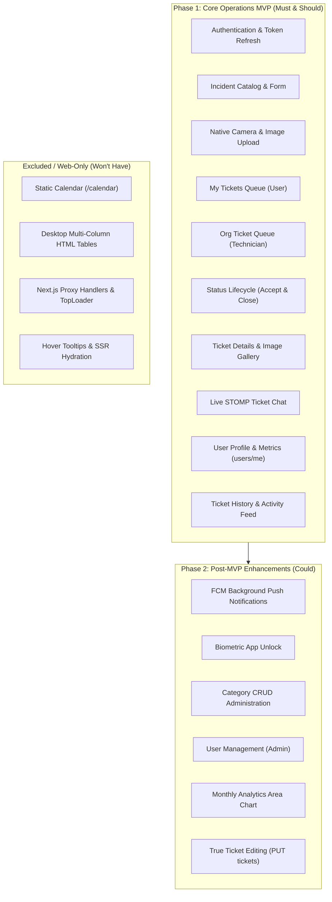

# Reconciled Mobile MVP Scope & Feature Specification

> **Audience**: Flutter Mobile Engineering Team, Product Owner & QA  
> **Source Verification**: Reconciled against [`mobile-migration/03-features.md`](file:///D:/Course%20Wing/Final/fix/helpdesk-frontend/docs/mobile-migration/03-features.md), [`backend-analysis/03-endpoints.md`](file:///D:/Course%20Wing/Final/fix/helpdesk/docs/backend-analysis/03-endpoints.md), and real backend implementations in [`helpdesk`](file:///D:/Course%20Wing/Final/fix/helpdesk).

---

## 1. Scope Strategy & Persona Matrix

The Flutter mobile application will focus on the operational core of the Helpdesk system: enabling employees to report incidents quickly using native camera attachments, allowing technicians to triage and resolve issues in the field, and facilitating real-time chat between both parties. Administrative management features (user provisioning, department creation) are secondary and deferred to Phase 2.

### Role Access Matrix for Mobile

| Feature Capability | Regular User (`USER`) | Field Technician (`TECHNICIAN`) | Administrator (`ADMIN`) |
|---|:---:|:---:|:---:|
| Email / Password Login & Auto Refresh | ✅ | ✅ | ✅ |
| Incident Catalog & Template Selection | ✅ | ✅ | ✅ |
| Create Ticket with Photos (Camera/Gallery) | ✅ | ✅ | ✅ |
| View "My Tickets" Feed | ✅ | ✅ | ✅ |
| View Organization Ticket Queue | ❌ | ✅ | ✅ |
| Accept Pending Ticket (`IN_PROGRESS`) | ❌ | ✅ | ✅ |
| Close Active Ticket (`COMPLETED`) | ❌ | ✅ | ✅ |
| Live STOMP Ticket Chat | ✅ (Own tickets) | ✅ (Assigned tickets) | ✅ (All tickets) |
| Ticket History Archive | ✅ (Own history) | ✅ (Assigned history)| ✅ (Org history) |
| Profile & Personal Stats (`/users/me`) | ✅ | ✅ | ✅ |
| KPI Overview Cards | ❌ | ✅ (3 cards) | ✅ (4 cards) |
| Category Administration | ❌ | Phase 2 | Phase 2 |
| User Directory & Provisioning | ❌ | ❌ | Phase 2 |

---

## 2. MUST HAVE: Phase 1 Core Operations MVP

---

### M-01: Secure Authentication & Session Continuity
* **User Story**: *As an employee, I want to securely sign in using my corporate email and password so that I can access my designated helpdesk role.*
* **Target Roles**: `USER`, `TECHNICIAN`, `ADMIN`
* **Backend Capabilities**:
  - `POST /api/v1/auth/login`: Validates credentials, issues JWT access token (15-min) and UUID refresh token (7-day).
  - `POST /api/v1/auth/refresh`: Issues a refreshed JWT access token.
  - `POST /api/v1/auth/logout`: Revokes the refresh token from PostgreSQL.
  - `GET /api/v1/users/me`: Populates user profile, `id`, and role claims.
* **Mobile Implementation**:
  - `LoginScreen` with email and password inputs, form validation, password visibility toggle.
  - Hardware-backed token storage via `flutter_secure_storage`.
  - Dio `QueuedInterceptor` providing automatic 401 interception, seamless token refresh, and request retry without user disruption.
  - Declarative route redirection in `GoRouter` based on user role (`USER` navigates to My Tickets; `TECHNICIAN`/`ADMIN` navigates to Ticket Queue).
* **Workarounds / Constraints**:
  - Because `AuthResponse` lacks user `id` (see [01-backend-changes-required.md](file:///D:/Course%20Wing/Final/fix/helpdesk_mobile/docs/01-backend-changes-required.md#b-02-authresponse-lacks-user-id-and-avatar-url)), Flutter must automatically call `GET /api/v1/users/me` immediately after a successful login to capture `id` and `imageUrl`.

---

### M-02: Incident Catalog & Template Selection
* **User Story**: *As an employee, I want to browse IT issue categories and select specific incident templates so that my problem is routed to the correct technician.*
* **Target Roles**: `USER`, `TECHNICIAN`, `ADMIN`
* **Backend Capabilities**:
  - `GET /api/v1/categories`: Returns hierarchical category tree (`id`, `name`, `description`, `subCategories`).
* **Mobile Implementation**:
  - Searchable Category Grid displaying cards with dynamic Lucide/Material icons mapped by category name (`Hardware` -> `laptop`, `Network` -> `wifi`, `Security` -> `shield`).
  - Tapping a category displays a modal bottom sheet or sub-issue list showing selectable incident templates.
  - Tapping a template navigates to the Ticket Submission Screen with pre-populated `categoryId` and `subCategoryId`.

---

### M-03: Ticket Submission with Native Camera & Multi-Photo Attachments
* **User Story**: *As an employee, I want to snap photos of broken hardware or screen error codes and submit an incident report so that technicians have immediate visual context.*
* **Target Roles**: `USER`, `TECHNICIAN`, `ADMIN`
* **Backend Capabilities**:
  - `POST /api/v1/images/upload`: Accepts `multipart/form-data` with form field `file`, stores binary in Supabase Storage bucket `Image`, returns public URL.
  - `POST /api/v1/tickets`: Accepts `TicketRequest` (`ticketTitle`, `description`, `priority`, `categoryId`, `subCategoryId`, `imageUrls`).
* **Mobile Implementation**:
  - Form inputs: Priority selector chips (`LOW`, `MEDIUM`, `HIGH`), multi-line description input with character count.
  - Attachment tray powered by `image_picker`: Bottom sheet offering "Take Photo" (Camera) and "Choose from Gallery" (Photos).
  - Client-side image compression using `flutter_image_compress` to guarantee files stay below the 5MB backend ceiling.
  - Concurrent image upload with visual progress bars.
  - Haptic feedback and confirmation toast on successful submission.

---

### M-04: User Ticket Queue ("My Tickets")
* **User Story**: *As a regular employee, I want to view a real-time list of all tickets I have submitted so that I know their current handling status.*
* **Target Roles**: `USER` (also accessible to `TECHNICIAN` and `ADMIN`)
* **Backend Capabilities**:
  - `GET /api/v1/tickets/my`: Returns active tickets (`PENDING` or `IN_PROGRESS`) where `createdBy == currentUserId`.
* **Mobile Implementation**:
  - Touch-optimized card list (`ListView.builder`) replacing desktop table rows.
  - Cards show: Formatted ticket ID (`#TCK-012`), title, category chip, priority badge, status badge (`Pending`, `In Progress`), and relative timestamp.
  - Pull-to-refresh gesture (`RefreshIndicator`).
  - Empty state with friendly illustration and "Report an Issue" CTA button.

---

### M-05: Organization Ticket Queue (Field Technician)
* **User Story**: *As a technician, I want to view all open tickets across the organization so that I can claim unassigned tickets and begin work.*
* **Target Roles**: `TECHNICIAN`, `ADMIN`
* **Backend Capabilities**:
  - `GET /api/v1/tickets`: Returns all non-deleted tickets in `PENDING` or `IN_PROGRESS` status across the organization.
* **Mobile Implementation**:
  - Filter chips at the top: `ALL`, `PENDING`, `IN_PROGRESS`.
  - Visual urgency indicator: Tickets with `HIGH` priority and `PENDING` status display a bold red accent border.
  - Quick action swipe (`flutter_slidable`): Swipe right on a `PENDING` ticket to trigger immediate "Accept".

---

### M-06: Ticket Status Lifecycle Management
* **User Story**: *As a technician, I want to accept pending tickets and close resolved tickets with status notes so that lifecycle records are maintained.*
* **Target Roles**: `TECHNICIAN`, `ADMIN`
* **Backend Capabilities**:
  - `PATCH /api/v1/tickets/{id}/status`: Accepts `{ "status": "IN_PROGRESS", "remark": "..." }` or `{ "status": "COMPLETED", "remark": "..." }`. Automatically assigns unassigned tickets to the calling technician.
* **Mobile Implementation**:
  - Prominent sticky action bar on the ticket detail screen:
    - If `PENDING`: Blue "Accept Ticket" button.
    - If `IN_PROGRESS`: Green "Close Ticket" button (opens remark dialog).
    - If `COMPLETED`: Status badge displays "Completed - Closed" (buttons hidden).
  - Automatic cache invalidation updates both queue counts and detail states immediately.

---

### M-07: Ticket Detail View & Multi-Image Gallery
* **User Story**: *As a user or technician, I want to inspect all details, photos, and status progression logs of a ticket in a clean mobile view.*
* **Target Roles**: `USER`, `TECHNICIAN`, `ADMIN`
* **Backend Capabilities**:
  - `GET /api/v1/tickets/{id}`: Returns complete ticket details including embedded `logs` array.
* **Mobile Implementation**:
  - Collapsible metadata header (Ticket ID, Status, Priority, Requester, Department, Assigned Technician).
  - Description card with selectable text.
  - Attachment carousel/grid using `cached_network_image`. Tapping any image opens a full-screen zoomable lightbox (`photo_view`).
  - Step progress indicator visualizing the ticket's `logs` timeline (`PENDING` -> `IN_PROGRESS` -> `COMPLETED`).

---

### M-08: Real-Time Bidirectional Ticket Chat (STOMP over WebSocket)
* **User Story**: *As a requester or assigned technician, I want to exchange messages in real-time within the ticket screen so that we can coordinate troubleshooting.*
* **Target Roles**: `USER`, `TECHNICIAN`, `ADMIN`
* **Backend Capabilities**:
  - REST History: `GET /api/v1/tickets/{ticketId}/messages`.
  - WebSocket STOMP Handshake: `/ws-chat`.
  - STOMP Topic Subscription: `/topic/ticket/{ticketId}`.
  - STOMP Send Destination: `/app/chat` with body `{ ticketId, senderId, sender, content }`.
* **Mobile Implementation**:
  - `stomp_dart_client` integration connecting to native raw WebSocket endpoint.
  - Chat bubbles: Right-aligned indigo bubbles for current user; left-aligned gray bubbles for other participants.
  - Sticky bottom input bar with automatic keyboard offset padding (`MediaQuery.viewInsetsOf(context).bottom`).
  - Auto-scroll to bottom on incoming messages.
  - Reconnection retry logic on network loss.

---

### M-09: User Profile & Personal Metrics
* **User Story**: *As a user, I want to see my profile info, department, and ticket resolution statistics.*
* **Target Roles**: `USER`, `TECHNICIAN`, `ADMIN`
* **Backend Capabilities**:
  - `GET /api/v1/users/me`: Returns user info and computed metrics (`ticketsCreated`, `ticketsAssigned`, `ticketsResolved`, `ticketsOpen`).
* **Mobile Implementation**:
  - Avatar display with fallback initials.
  - Department and role badge.
  - Metric cards 2x2 grid showing personal ticket counters.
  - Log Out action button with confirmation dialog.

---

## 3. SHOULD HAVE: Phase 1 Polish & Fast Follow

---

### S-01: Completed Ticket History Archive
* **User Story**: *As a user or technician, I want to review past completed tickets and see their completion timestamps.*
* **Backend Endpoint**: `GET /api/v1/tickets/history`
* **Implementation**: Tab or view showing archived tickets with `completedAt` timestamp.

---

### S-02: Technician & Admin KPI Summary Cards
* **User Story**: *As a technician or admin, I want to see total ticket counts at a glance.*
* **Backend Endpoint**: `GET /api/v1/tickets/stats`
* **Implementation**: Top horizontal scrolling banner or grid on the technician dashboard displaying Total, Pending, and Completed counters.

---

### S-03: In-App Activity Feed / Notification Drawer
* **User Story**: *As a user, I want to see recent activity updates on tickets I care about.*
* **Backend Endpoint**: `GET /api/v1/tickets/activity`
* **Implementation**: Slide-over notification sheet displaying recent status changes and technician assignments.

---

### S-04: Pull-to-Refresh & Infinite Scrolling
* **Mobile Implementation**: Seamless `RefreshIndicator` on all lists and automatic page incrementation (`?page=N&size=15`) as the user scrolls near the list bottom.

---

### S-05: Dark Mode & Light Mode Theming
* **Mobile Implementation**: Custom `ThemeData` tokens matching the web Satoshi typography and Tailwind color system (`#5750F1` primary, `#020D1A` dark background).

---

## 4. COULD HAVE: Phase 2 Post-MVP

---

### C-01: Firebase Cloud Messaging (FCM) Push Notifications
* **Description**: Deliver native OS push alerts when the app is closed/backgrounded upon ticket assignment, status updates, or chat messages. Requires backend `POST /api/v1/notifications/device-token`.

---

### C-02: Biometric App Lock
* **Description**: Face ID / Touch ID unlock via `local_auth` so users do not have to re-enter email/password on app resume.

---

### C-03: Category & Subcategory Administration
* **Description**: Mobile CRUD screens for `POST /categories` and `DELETE /categories/{id}`. (Currently administrative and rarely used on mobile).

---

### C-04: User Directory & Account Provisioning
* **Description**: Mobile admin screens for `GET /users`, `POST /users`, `PUT /users/{id}`, `DELETE /users/{id}`.

---

### C-05: Monthly Ticket Volume Trend Chart
* **Description**: Mobile area spline chart mapping `GET /api/v1/tickets/stats/monthly` using `fl_chart`.

---

### C-06: Ticket Detail Editing
* **Description**: Wire mobile edit forms to backend `PUT /api/v1/tickets/{id}` after backend team adds creator ownership checks.

---

## 5. WON'T HAVE / EXCLUDED (Web-Only & Deprecated)

1. **Static Calendar (`/calendar`)**: Disconnected leftover web template asset; contains no real backend data. Completely excluded.
2. **Desktop Multi-Column HTML Tables**: Replaced entirely with responsive Flutter cards.
3. **Next.js Reverse Proxy Layer**: Native mobile HTTP calls connect directly to the Spring Boot host.
4. **Desktop Hover Tooltips**: Replaced with explicit subtitle dates.
5. **Incomplete `/tickets/[id]/edit` Web View**: Deprecated in favor of the unified ticket detail view.
